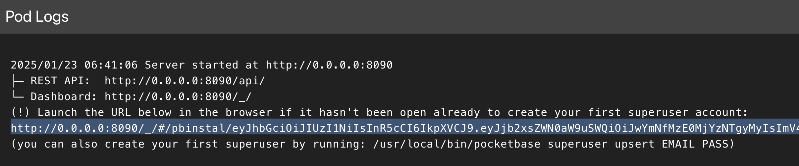

PocketBase is an open-source backend in a single file, with a realtime database, authentication, file storage, and an admin dashboard. Once you have [deployed PocketBase on PikaPods](https://www.pikapods.com/apps/pocketbase), here are a few common scenarios you might face. Anything else is covered in the [official PocketBase docs](https://pocketbase.io/docs/).

## First-time Admin Setup

Starting with PocketBase version 0.23.x, the initial admin setup process has changed. To create your first superuser account, follow these steps:

1. After creating your PocketBase pod, go to [Pod > More > Show Logs](https://docs.pikapods.com/manage/debug#check-logs)
2. Look for a line containing a URL that starts with `http://0.0.0.0:8090/_/#/pbinstal/` followed by a JWT token

   

3. Copy this URL and replace `http://0.0.0.0:8090` with your pod's URL (`https://<YOUR_POD_SLUG>.pikapod.net`)
4. Open the modified URL in your browser to access the setup page
5. Follow the on-screen instructions to create your admin account
